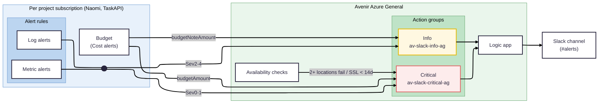

Alerts tell us when something in production has gone wrong, or is about to, so we can fix it before users notice or before it costs us money. They are posted to the `#alerts` Slack channel, and each message has information about what has gone wrong and what to do about it.

The alerts are built on [Azure Monitor](https://learn.microsoft.com/en-us/azure/azure-monitor/overview), Azure's built-in monitoring service. All alerts live in the [azure-alerts](https://github.com/AvenirHealth-org/azure-alerts) repo and are configured/deployed with [Bicep](https://learn.microsoft.com/en-us/azure/azure-resource-manager/bicep/overview). See its README for the full details.

## What we alert on

There are currently four kinds of alert:

| Kind             | What it watches                                                   | Example                                          |
| ---------------- | ----------------------------------------------------------------- | ------------------------------------------------ |
| **Availability** | Public/live sites are checked every 5 minutes from 3 locations    | AIM is down, or its SSL certificate expires soon |
| **Metric**       | An Azure metric on a resource crosses a threshold                 | Redis memory above 90%, Postgres not responding  |
| **Log**          | A KQL query against a Log Analytics workspace returns enough rows | A worker job timed out                           |
| **Budget**       | Monthly spend on a project's subscription or resource groups      | Project spend has passed the monthly budget      |

## Severity

Every alert has a severity from 0 (most severe) to 4, which decides how it is posted:

- **Sev0 and Sev1** are 🚨 **Critical**. Something is broken for users now, or will be very soon. Look at these straight away.
- **Sev2 to Sev4** are ⚠️ **Warning**. Something needs attention, but not urgently.

When an alert clears, a ✅ **Resolved** message is posted. One-off events, such as a job timing out, don't send a Resolved message.

Budgets send a ℹ️ **Spend note** when spend reaches an early threshold, and an 🚨 **Over budget** message when it reaches the monthly budget. Azure cost data lags by up to a day, so these arrive after the money has been spent.

## Architecture

- A shared deployment in the Avenir Azure General subscription (`AzureAlerts-RG`) holds a logic app that formats alerts and posts them to Slack, two action groups that call it, and the availability checks.
- Each project has its own deployment in its own subscription, so its alerts can see its resources and set a budget. Its alerts send to the shared action groups.
- Some alerts are generated from the app's own config, so they stay in step with it. For example, the Naomi worker timeout alert reads each worker's timeout from `config/workers.json` in hint-deploy-azure, and the Task API has a runaway-executions alert for every worker job in `Runner/task_config.json` in TaskAPIServer.
- Everything is deployed with the `start-alerts` script, as Azure [deployment stacks](https://learn.microsoft.com/en-us/azure/azure-resource-manager/bicep/deployment-stacks). The stack owns its resources. To create or edit alerts, change the Bicep code and redeploy. Note that removing an alert from the Bicep deletes it from Azure on the next deploy, and renaming one deletes the old alert and creates a new one.

## Adding an alert

1. Clone [azure-alerts](https://github.com/AvenirHealth-org/azure-alerts).
1. Install dependencies listed in the "Requirements" section of the README.
1. To add a new alert to an existing project, follow the steps listed in the "Adding alerts" section of the README.
1. To add alerts for a new project, follow the steps listed in the "Adding a project" section of the README.

## When an alert fires

1. **Read the message in `#alerts`.** It has the alert name, what has gone wrong, the action to take, and where relevant the measured value against the threshold, the affected resource (e.g. the job name or task ID) and a **View logs** link.
1. **Follow the action.** It says where to look and the usual fix.
1. **Fix the alert if it was wrong.** If it fired on normal usage, or the action didn't help, update the threshold or the action text in azure-alerts so the next person has a better time of it.
