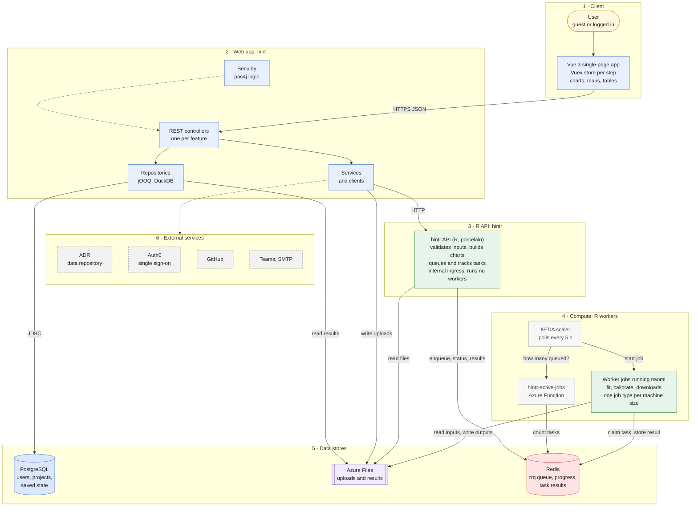

This page is the starting point. For what each endpoint does, see [endpoint flows](../endpoint-flows).

## Overview

Read top to bottom: the user's browser talks to **hint** (Kotlin), which keeps projects in Postgres and hands anything involving the model or R to **hintr** (R). hintr puts long-running work on a queue in Redis, and short-lived **worker jobs** pick it up and run naomi.

## What each layer is

| # | Layer | What it does | Built with | Repo | Runs on |
| --- | --- | --- | --- | --- | --- |
| 1 | **Client** | The wizard the user steps through: upload inputs, review, fit, calibrate, explore and download results. Polls task status every 2 s. | Vue 3 (compat build), Vuex, Chart.js, Plotly, Leaflet, ag-grid. Served as static files by hint. | [hint](https://github.com/hivtools/hint), `src/app/static` | The user's browser |
| 2 | **Web app: hint** | The only thing the browser talks to. Owns users, projects, versions and saved state. Stores uploads, serves result data, and proxies everything involving R. Login is by password, Auth0 single sign-on, or (for debug downloads) a GitHub token. | Kotlin, Spring Boot 2.7, pac4j, jOOQ, DuckDB JDBC, Freemarker (login pages) | [hint](https://github.com/hivtools/hint), `src/app` | Azure App Service (Linux container, VNet-integrated), mounting the `uploads` and `results` file shares |
| 3 | **R API: hintr** | Synchronous R work: validating inputs, building chart data and option forms. Also the task API: accepts jobs, reports status and progress, returns results. Started with `--workers 0`, so it never runs the model itself. | R, porcelain, rrq, naomi, naomi.options | [hintr](https://github.com/hivtools/hintr) | Azure Container App, internal ingress (VNet only), 2 vCPU / 4 GiB, 0 to 4 replicas |
| 4 | **Compute: R workers** | Run naomi: model fit, calibrate and each download type. Each job execution takes one task and exits. A KEDA scaler asks the `hintr-active-jobs` function how many tasks are queued or running per queue and starts job executions (up to 10 at once, polled every 5 s). Country-to-machine-size routing is configuration. | Same R image as hintr (`hintr-worker`), `hintr_worker_single_job`. Function: TypeScript on Node 24. | [hintr](https://github.com/hivtools/hintr), [hintr-active-jobs](https://github.com/hivtools/hintr-active-jobs), [naomi](https://github.com/mrc-ide/naomi) and [naomi.options](https://github.com/mrc-ide/naomi.options), `config/workers.json` in [hint-deploy-azure](https://github.com/hivtools/hint-deploy-azure) | Azure Container App Jobs, one per size: consumption-small, consumption-large, dedicated-medium, dedicated-large, dedicated-larger |
| 5 | **Data stores** | **Postgres**: users, projects, versions, saved state (includes task IDs) and the uploaded-file index. **Redis**: the rrq queue, status, progress, and task results and inputs. **Azure Files**: uploaded inputs (named by content hash) and everything workers write. | PostgreSQL 17, Azure Managed Redis (AOF persistence), Azure Files Premium (`uploads` 100 GiB, `results` 500 GiB, `config` 100 GiB) | Schema and migrations in [hint-db](https://github.com/hivtools/hint-db) | Azure, all behind private endpoints in one VNet |
| 6 | **External services** | **ADR** for importing and publishing datasets, **Auth0** for single sign-on, **GitHub** for the debug-access check, **Teams** for error reports and **SMTP** for password email. | | | Third parties |

Not in the diagram, because they are not part of the running request path:

| Area | What exists |
| --- | --- |
| **Infrastructure** | [hint-deploy-azure](https://github.com/hivtools/hint-deploy-azure): Bicep deployed with deployment stacks by the `start-*` scripts (network, storage, environment, containers, alerts, backup, observability). |
| **Build and delivery** | GitHub Actions in each repo test and push images to `ghcr.io` (`hint`, `hintr`, `hintr-worker`). Production runs the mutable `:main` tags. |
| **Monitoring** | Log Analytics and Application Insights, an availability test on naomi.unaids.org, and alerts and a budget that notify Slack. |
| **Backups** | Azure Backup for the file shares (daily) and for Postgres. A Logic App exports Redis to blob storage every 15 days. |
| **Other repos** | [naomi.docker](https://github.com/mrc-ide/naomi.docker) builds the `naomi-base` R image. [hint-proxy-azure](https://github.com/hivtools/hint-proxy-azure) is an nginx proxy that stopped fronting hint in Feb 2025 and is not deployed by hint-deploy-azure, so check whether it is still running. |

## Where to go next

- **What each endpoint does** and how a user action flows through every layer: [endpoint-flows.md](endpoint-flows.md).
